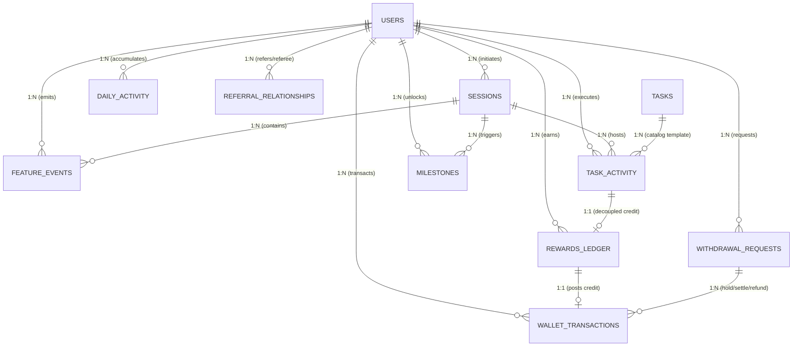

# VELOOP REWARDS — LOGICAL DATA MODEL DOCUMENTATION

**Author:** Senior Data Analyst & Database Architect  
**Project:** VELOOP Rewards Data Analyst Internship (Task 01)  
**Execution Scope:** Days 16–18 (Data Architecture & Logical Modeling)  
**Document Generation Date:** 24 November 2026  
**Document Status:** Complete & Audited  
**Repository Location:** `documentation/Data_Model_Documentation.md`  

---

## 1. Executive Summary & Architecture Paradigm

The VELOOP Rewards data architecture is structured around a hybrid relational model optimized for:
1. **Third Normal Form (3NF) Ingestion & Ledgering:** Ensuring zero update anomalies, atomic financial consistency, and strict referential integrity across transactional tables.
2. **Dimensional Star Schema Presentation:** Supporting high-performance Power BI reporting and analytical queries without slow multi-table snowflaking.

### Critical Decoupling Milestone
The central architectural innovation in this model is the **complete decoupling of operational task telemetry from the financial ledger**:
- In the original raw pack, `reward_status` was conflated directly onto `05_Task_Activity`.
- In our target logical model, `task_activity` logs operational attempts, while `rewards_ledger` and `wallet_transactions` manage atomic double-entry balance credits, debit reversals, and multi-currency mutations.

---

## 2. Visual Entity-Relationship Architecture

The visual diagram is rendered and available at [Entity_Relationship_Diagram.png](file:///d:/VELOOPS_DATA_ANALYTICS/VELOOP-Product-Analytics/documentation/Entity_Relationship_Diagram.png). The editable Mermaid definition is stored in [Entity_Relationship_Diagram.mmd](file:///d:/VELOOPS_DATA_ANALYTICS/VELOOP-Product-Analytics/documentation/Entity_Relationship_Diagram.mmd).

---

## 3. Entity Classification & Cardinality Rules

### Core Dimension Entities

#### 1. `users` (Central Conformed Dimension)
- **Primary Key:** `user_id` (Regex `^VLUSR\d{6}$`).
- **Cardinality:** 1:N with `sessions`, `feature_events`, `task_activity`, `wallet_transactions`, `withdrawal_requests`.
- **Integrity Rule:** Deleting a user is prohibited if child ledger transactions exist (`ON DELETE RESTRICT`).

#### 2. `tasks` (Offerwall & Earning Catalog Dimension)
- **Primary Key:** `task_id` (Regex `^TASK\d{4}$`).
- **Cardinality:** 1:N with `task_activity`. Defines the template properties (category, offered reward, advertiser partner).

### Operational Fact Entities

#### 3. `sessions` (User Visit Telemetry Fact)
- **Primary Key:** `session_id` (Regex `^SESS\d{7}$`).
- **Foreign Key:** `user_id` -> `users.user_id` (`ON DELETE RESTRICT`).
- **Cardinality:** 1:N with `feature_events` and `task_activity`.
- **Constraint:** `session_start <= session_end`; duration non-negative.

#### 4. `feature_events` (Granular Clickstream Fact)
- **Primary Key:** `event_id` (Regex `^EVT\d{8}$`).
- **Foreign Keys:** `user_id`, `session_id`.
- **Grain:** One row per atomic user action across the 15 supported features.

#### 5. `task_activity` (Operational Earning Fact)
- **Primary Key:** `activity_id` (Regex `^ACT\d{7}$`).
- **Foreign Keys:** `user_id`, `task_id`, `session_id`.
- **Grain:** One row per task execution attempt. Captures 8 categories and 5 failure reasons.

### Proposed Financial & Relational Ledger Entities

#### 6. `rewards_ledger` (Decoupled Reward Distribution Fact)
- **Primary Key:** `reward_transaction_id` (Regex `^RWD\d{12}$`).
- **Foreign Keys:** `activity_id` (`ON DELETE RESTRICT`), `user_id`.
- **Unique Constraint:** `idempotency_hash` (`SHA256(user_id, activity_id, currency, amount)`).

#### 7. `wallet_transactions` (Double-Entry Balance Ledger Fact)
- **Primary Key:** `wallet_transaction_id` (Regex `^WLT\d{12}$`).
- **Foreign Key:** `user_id`.
- **Mathematical Invariant:** `balance_after = balance_before +/- amount`.

#### 8. `withdrawal_requests` (Payout Pipeline Fact)
- **Primary Key:** `withdrawal_id` (Regex `^WDR\d{12}$`).
- **Foreign Key:** `user_id`.
- **Fulfillment States:** `REQUESTED` -> `PROCESSING` -> `COMPLETED` / `REJECTED` / `REVERSED`.

#### 9. `referral_relationships` (Directed Viral Graph Fact)
- **Primary Key:** `referral_id` (BigSerial).
- **Foreign Keys:** `referrer_user_id` -> `users.user_id`, `referee_user_id` -> `users.user_id` (UNIQUE).
- **Self-Referral Constraint:** `CHECK (referrer_user_id <> referee_user_id)`.

---

## 4. Referential Integrity & Relational Verification

In our Phase 0 automated audit, `DatasetInspector.check_referential_integrity` verified:
- `user_id` foreign key validation across all 5 child tables against `Users_1000_Clean` achieved **100.0% integrity (0 orphan records)**.
- `session_id` foreign key validation across `Feature_Events` and `Task_Activity` achieved **100.0% integrity (0 orphan records)**.
- In `06_Milestones`, 40 records exhibit null `session_id`, correctly isolated as asynchronous background cron executions.

---

## 5. Deliverable References

- Master Data Dictionary: [Data_Dictionary.xlsx](file:///d:/VELOOPS_DATA_ANALYTICS/VELOOP-Product-Analytics/documentation/Data_Dictionary.xlsx)
- Editable Mermaid Model: [Entity_Relationship_Diagram.mmd](file:///d:/VELOOPS_DATA_ANALYTICS/VELOOP-Product-Analytics/documentation/Entity_Relationship_Diagram.mmd)
- Visual PNG Render: [Entity_Relationship_Diagram.png](file:///d:/VELOOPS_DATA_ANALYTICS/VELOOP-Product-Analytics/documentation/Entity_Relationship_Diagram.png)
- Production DDL: [sql/Proposed_Database_Schema.sql](file:///d:/VELOOPS_DATA_ANALYTICS/VELOOP-Product-Analytics/sql/Proposed_Database_Schema.sql)
