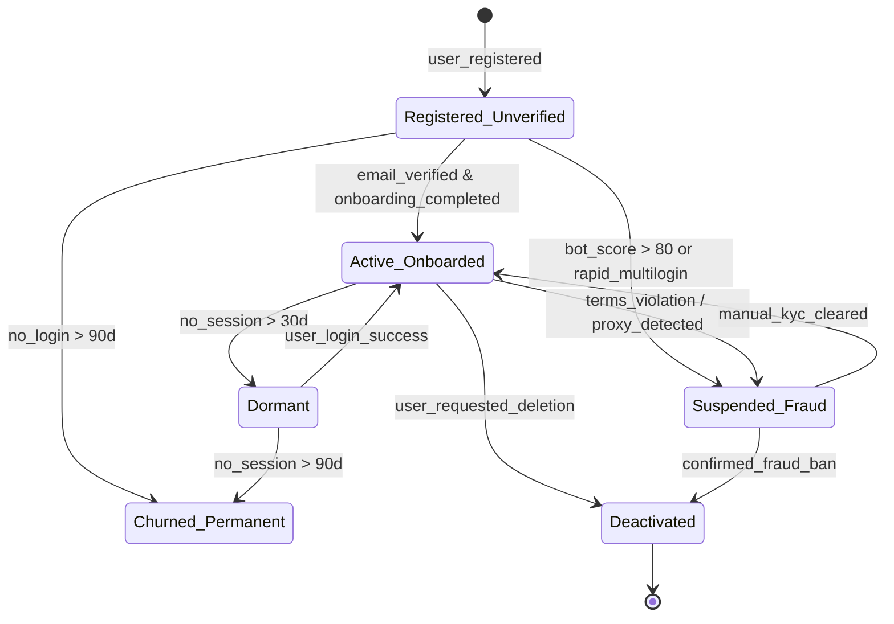

# VELOOP REWARDS — USER & ACCOUNT ANALYTICS SPECIFICATION REPORT

**Author:** Senior Data Analyst & Growth Engineering Mentor  
**Project:** VELOOP Rewards Data Analyst Internship (Task 01)  
**Execution Period Scope:** Days 5–6 (31 October 2026 – 01 November 2026)  
**Document Generation Date:** 13 November 2026  
**Document Status:** Complete & Audited  
**Repository Location:** `reports/User_Account_Analytics_Report.md`  

---

## 1. Executive Summary & Intent

User and account analytics forms the spine of all downstream product analytics. In a gamified rewards application like **VELOOP**, an analyst must track not only who the user is, but also their security integrity, session velocity, onboarding drop-offs, and state transitions from curious first-time visitor to power earner.

During **Days 5–6**, we established the formal **User & Account Analytics Specification**, resolving the ambiguity between static database attributes and dynamic event tracking.

### Core Architecture Highlights
1. **Three-Tier Identification Standard:** Strict enforcement of globally unique, regex-validated identifiers across Users (`VLUSR######`), Sessions (`SESS#######`), and Events (`EVT########`).
2. **Account Lifecycle State Machine:** Formulation of a 6-stage lifecycle model (`Registered_Unverified` -> `Active_Onboarded` -> `Dormant` -> `Suspended_Fraud` -> `Deactivated` / `Churned_Permanent`).
3. **Closing the Identity Telemetry Gap:** Transitioning from passive profile polling to an active, real-time behavioral event stream capturing registration friction, authentication success/failure, and onboarding step-level drop-offs.
4. **Data Contract & Integrity Rules:** Comprehensive validation rules covering age bounds, timestamp chronology, non-negative XP balances, and geographic standardizations.

---

## 2. Standardized Identifier Taxonomy

To enable joins across high-volume event streams, operational relational databases, and analytical data warehouses, VELOOP enforces a standardized identifier hierarchy:

```
+-------------------------------------------------------------------------------------------------------+
| VELOOP TELEMETRY IDENTIFIER TAXONOMY                                                                  |
+---------------+-------------------+---------------------+--------------------+------------------------+
| Identifier    | Format / Pattern  | Regex Validator     | Entity Scope       | Current Status         |
+---------------+-------------------+---------------------+--------------------+------------------------+
| user_id       | VLUSR + 6 digits  | ^VLUSR\d{6}$        | Global User Entity | CONFIRMED & VERIFIED   |
|               | (e.g. VLUSR000001)|                     |                    | (1,000 in Users_Clean) |
+---------------+-------------------+---------------------+--------------------+------------------------+
| session_id    | SESS + 7 digits   | ^SESS\d{7}$         | User App Session   | CONFIRMED & VERIFIED   |
|               | (e.g. SESS0000001)|                     |                    | (7,913 in Sessions)    |
+---------------+-------------------+---------------------+--------------------+------------------------+
| event_id      | EVT + 8 digits    | ^EVT\d{8}$          | Atomic Telemetry   | CONFIRMED & VERIFIED   |
|               | (e.g. EVT00000001)|                     | Event              | (35,704 in Events)     |
+---------------+-------------------+---------------------+--------------------+------------------------+
| device_id     | Standard UUID v4  | ^[a-f0-9\-]{36}$    | Physical Hardware  | PROPOSED SPECIFICATION |
|               |                   |                     | Instance           | (Mitigate bot farms)   |
+---------------+-------------------+---------------------+--------------------+------------------------+
| install_id    | Standard UUID v4  | ^[a-f0-9\-]{36}$    | App Installation   | PROPOSED SPECIFICATION |
|               |                   |                     | Instance           | (Measure install CAC)  |
+---------------+-------------------+---------------------+--------------------+------------------------+
```

### Key Technical Rule:
- Under no circumstances may an `event_id` or `session_id` be generated client-side without an associated `user_id` once authentication has occurred. For pre-authentication events (e.g. initial app open, landing screen), an ephemeral `anonymous_id` (derived from `install_id`) is emitted, which is aliased to the permanent `user_id` immediately upon account creation.

---

## 3. Account Lifecycle State Machine

Users transition through distinct lifecycle stages that dictate platform access, feature unlocking, and financial cashout permissions:



### Stage Definitions & Rules
1. **Registered_Unverified:** Initial state upon successful submission of the signup form. Users can explore UI and complete micro-tasks (Tap & Earn), but are **strictly prohibited from executing withdrawals or currency exchanges**.
2. **Active_Onboarded:** Full-featured state achieved after email verification and onboarding completion. User is eligible for all task categories, streaks, and wallet functions.
3. **Dormant:** Triggered automatically when an active user records 0 sessions across a rolling 30-day window (`days_since_last_login > 30`). Triggers automated win-back push notifications.
4. **Suspended_Fraud:** Security lock triggered when velocity limits, CAPTCHA failure thresholds, or IP proxy rules are tripped. All pending withdrawals and reward allocations are frozen.
5. **Deactivated:** User-requested account closure (GDPR / DPDP compliance) or administrative permanent ban. PII is scrubbed; immutable financial ledger records are retained for statutory tax compliance.

---

## 4. Closing the Telemetry Gap: Proposed Funnel Event Contracts

Currently, VELOOP only stores the end-state of a user in `Users_1000_Clean`. To measure acquisition funnel drop-offs, the following event schemas must be implemented by frontend engineers:

### 4.1 Registration Funnel Events
```json
// Event: registration_step_completed
{
  "event_id": "EVT00035705",
  "install_id": "a9b8c7d6-e5f4-4321-ba98-fedcba098765",
  "event_name": "registration_step_completed",
  "timestamp_utc": "2026-10-31T14:22:15Z",
  "properties": {
    "step_name": "demographic_details",
    "step_index": 2,
    "total_steps": 3,
    "duration_seconds": 42.5,
    "acquisition_channel": "Google Ads",
    "referral_code_entered": "VEL2026VIP"
  }
}
```

### 4.2 Authentication Events
```json
// Event: user_login_failed
{
  "event_id": "EVT00035706",
  "user_id": "VLUSR000105",
  "session_id": "SESS0007914",
  "event_name": "user_login_failed",
  "timestamp_utc": "2026-10-31T14:25:01Z",
  "properties": {
    "auth_method": "password",
    "failure_reason": "invalid_credentials",
    "consecutive_failures": 3,
    "client_ip": "103.21.124.89",
    "is_rate_limited": false
  }
}
```

### 4.3 Onboarding Walkthrough Events
```json
// Event: onboarding_step_viewed
{
  "event_id": "EVT00035707",
  "user_id": "VLUSR000105",
  "session_id": "SESS0007914",
  "event_name": "onboarding_step_viewed",
  "timestamp_utc": "2026-10-31T14:26:10Z",
  "properties": {
    "step_index": 1,
    "card_topic": "how_virtual_earnings_work",
    "time_spent_on_card_seconds": 12.8,
    "interaction_type": "swipe_forward"
  }
}
```

---

## 5. Empirical Verification of Current Users Dataset

Running `DataValidator.validate_users()` against `Users_1000_Clean` and `Users_Messy_Audit` yielded the following verified findings:

```
+---------------------------------------------------------------------------------------------------------+
| EMPIRICAL USER DATA VALIDATION RESULTS                                                                  |
+-------------------------------------+------------------+------------------+----------+------------------+
| Assertion / Business Rule           | Target Dataset   | Total Evaluated  | Passed   | Violations Found |
+-------------------------------------+------------------+------------------+----------+------------------+
| user_id Regex (^VLUSR\d{6}$)        | Users_Clean      | 1,000 rows       | 100.0%   | 0 violations     |
| Chronology (reg_date <= last_login) | Users_Clean      | 928 active rows  | 100.0%   | 0 violations     |
| Age Bounds (13 <= age <= 100)       | Users_Clean      | 1,000 rows       | 100.0%   | 0 violations     |
| Non-Negative XP Balance             | Users_Clean      | 1,000 rows       | 100.0%   | 0 violations     |
| Primary Key Uniqueness              | Users_Clean      | 1,000 rows       | 100.0%   | 0 duplicates     |
+-------------------------------------+------------------+------------------+----------+------------------+
| Primary Key Uniqueness              | Users_Messy      | 1,008 rows       | 99.2%    | 8 DUPLICATE IDs  |
| Non-Null registration_datetime      | Users_Messy      | 1,008 rows       | 99.9%    | 1 NULL VALUE     |
| Non-Null email_verification_status  | Users_Messy      | 1,008 rows       | 99.9%    | 1 NULL VALUE     |
+-------------------------------------+------------------+------------------+----------+------------------+
```

### Empirical Baseline Distributions (Users_1000_Clean):
- **User Verification:** 82.1% of registered users are email-verified (821 users), while 17.9% remain unverified (179 users).
- **Onboarding Completion:** 78.6% of users completed the onboarding walkthrough (786 users), while 21.4% abandoned it incomplete (214 users).
- **Dormancy on D0:** 72 users (7.2%) never logged in a second time after initial registration (`last_login_datetime IS NULL`).
- **Platform Concentration:** Mobile represents 84.1% of the user base, dominated by Android (71.3%), followed by iOS (18.2%) and Web (10.5%).

---

## 6. Analytical Use Cases & SQL Query Models

The user specification directly enables five core analytical use cases:

1. **Cohort Acquisition & Retention Analysis:** Segmenting users by `registration_datetime` cohort month and tracking their D1, D7, D14, and D30 return rates.
2. **Channel Quality & CAC Modeling:** Comparing the 30-day active retention of users acquired via `Facebook Ads` vs `Influencer` vs `Referral`.
3. **Bot Farm Isolation:** Detecting clusters of user accounts sharing identical `primary_device`, registration timestamps within seconds, and 0 active sessions.
4. **Onboarding Friction Detection:** Calculating the conversion drop-off between `registration_completed` and `first_task_started`.
5. **Demographic Yield Optimization:** Analyzing which age brackets and regional states produce the highest task completion rate and longest session durations.

---

## 7. Deliverable Artifact Reference

- `User_Analytics_Specification.xlsx` (Multi-sheet enterprise specification workbook)
- `sql/proposed_schema.sql` (Production DDL table definitions with foreign keys and checks)
