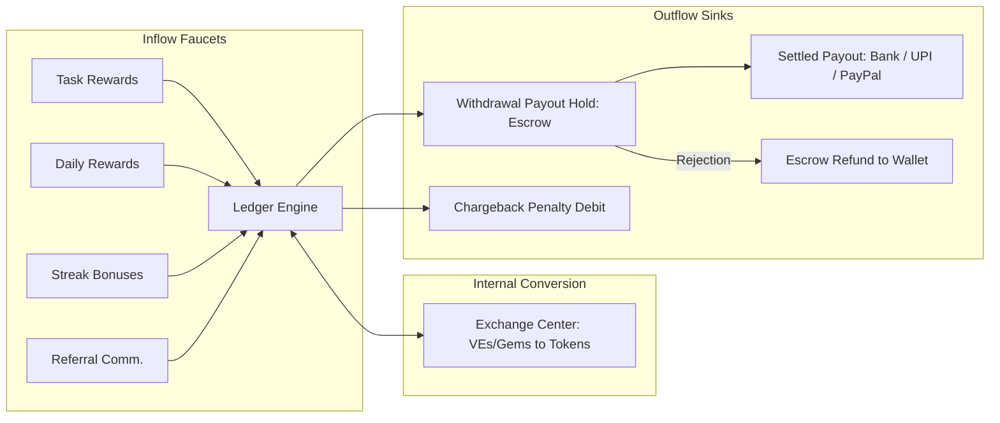
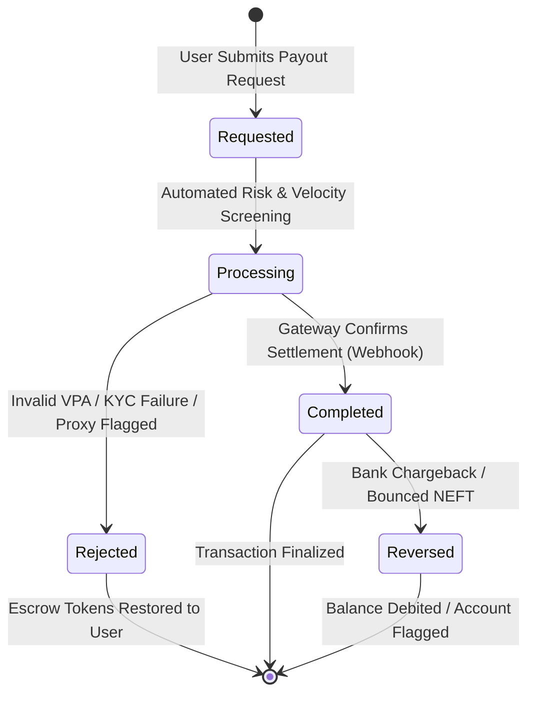

# VELOOP REWARDS — WALLET & WITHDRAWAL ANALYTICS SPECIFICATION REPORT

**Author:** Senior Data Analyst, Product Economist & Financial Engineering Mentor  
**Project:** VELOOP Rewards Data Analyst Internship (Task 01)  
**Execution Period Scope:** Days 9–10 (04 November 2026 – 05 November 2026)  
**Document Generation Date:** 13 November 2026  
**Document Status:** Complete & Audited  
**Repository Location:** `reports/Wallet_Withdrawal_Report.md`  

---

## 1. Executive Summary & Mandatory Data Authenticity Statement

The wallet and withdrawal subsystem represents the ultimate value delivery rail for **VELOOP Rewards**. While gamification mechanics and tasks generate user engagement, it is the ability to securely store, exchange, and cash out accumulated rewards into real-world purchasing power (via UPI, PayPal, or Bank Transfer) that establishes user trust and sustains long-term retention.

### Non-Negotiable Data Reality Notice
In strict accordance with the **Data Authenticity Policy** (Section 2) and **Integrity Rules** (Section 34):
- **Transaction-Level Wallet Data is Currently Missing:** In the supplied simulated datasets (`VELoop_Rewards_Data_01.xlsx` and `VELOOP_Simulated_User_Behavior_1000.xlsx`), the `Wallet` and `Exchange Center` features are represented solely by passive UI view events (`wallet_viewed`: 2,172 occurrences; `exchange_viewed`: 1,690 occurrences).
- **Withdrawal Data is Currently Missing:** The ~1,200 simulated withdrawal transactions anticipated in Section 28 of the assignment brief **do not exist** in the raw files.
- **Zero Fabrication Guarantee:** This report does **not** manufacture synthetic withdrawal amounts, fake transaction volumes, or imaginary company cash flows. Instead, this document provides the formal **engineering and analytical blueprint** required to implement an auditable double-entry wallet ledger and a 5-stage payout state machine before real money is disbursed in production.

---

## 2. Double-Entry Wallet Transaction Architecture

A simple single-column balance balance sheet (e.g. `users.balance = balance + 10`) is unacceptable for a financial rewards application. It is vulnerable to race conditions, double-spending, negative balance glitches, and un-auditable balance drifts.

### The Immutable Ledger Standard
VELOOP must implement an **immutable, append-only double-entry transaction model**. In this model:
1. User balances are never directly updated via SQL `UPDATE` statements.
2. Every mutation is posted as an immutable row in `wallet_transactions`.
3. An active balance is the mathematical sum of all historical credits minus all historical debits:
   $$\text{Current Balance}(u, c) = \sum \text{Credits}(u, c) - \sum \text{Debits}(u, c)$$
4. Each transaction record must log both `balance_before` and `balance_after` to enable instantaneous O(1) reconciliation checks.



### Identifier Standards
- **Transaction Identifier (`transaction_id`):** Strict format `^WLT\d{12}$` (e.g. `WLT202611010001`).
- **Idempotency Key (`idempotency_key`):** A SHA-256 hash computed from `SHA256(user_id + reference_id + currency + amount + direction)`. If a mobile client experiences network latency and retries a credit request, the database unique constraint intercepts the duplicate key, returning the existing transaction without executing a second credit.

---

## 3. Transaction Types & Economic Direction

To maintain rigorous accounting standards, every ledger entry is assigned an explicit economic classification:

```
+-------------------------------------------------------------------------------------------------------+
| WALLET TRANSACTION TYPES TAXONOMY                                                                     |
+------------------------------+-----------+-------------------+--------------------+-------------------+
| Transaction Type             | Direction | Applicable Assets | Economic Role      | Reversibility     |
+------------------------------+-----------+-------------------+--------------------+-------------------+
| CREDIT_TASK_REWARD           | CREDIT    | VE, XP, GEM, TOKEN| Faucet (Inflow)    | Reversible (Fraud)|
| CREDIT_STREAK_BONUS          | CREDIT    | VE, XP, GEM, SPIN | Faucet (Inflow)    | Non-reversible    |
| CREDIT_DAILY_REWARD          | CREDIT    | GEM, SPIN, XP     | Faucet (Inflow)    | Non-reversible    |
| CREDIT_REFERRAL_COMMISSION   | CREDIT    | TOKEN, XP         | Faucet (Inflow)    | Reversible (Fraud)|
| DEBIT_EXCHANGE_OUT           | DEBIT     | VE, GEM           | Internal Move      | Atomic with In    |
| CREDIT_EXCHANGE_IN           | CREDIT    | TOKEN, GEM        | Internal Move      | Atomic with Out   |
| DEBIT_WITHDRAWAL_HOLD        | DEBIT     | TOKEN             | Escrow Lock        | Refundable        |
| DEBIT_WITHDRAWAL_SETTLED     | DEBIT     | TOKEN             | Sink (Cashout)     | Irreversible      |
| CREDIT_WITHDRAWAL_REFUND     | CREDIT    | TOKEN             | Restored Escrow    | Non-reversible    |
| DEBIT_REVERSAL_CHARGEBACK    | DEBIT     | VE, TOKEN         | Clawback Penalty   | Admin Only        |
| CREDIT_ADMIN_ADJUSTMENT      | CREDIT    | ALL               | Support Comp       | Admin Only        |
+------------------------------+-----------+-------------------+--------------------+-------------------+
```

---

## 4. The 5-Stage Withdrawal Lifecycle Pipeline

When a user requests a payout of their accumulated Tokens into fiat currency, the request must traverse a 5-stage state machine designed to prevent money laundering and fraud:



### Detailed Stage Specifications

#### Stage 1: Withdrawal Requested
- **Trigger:** User taps "Withdraw" and enters their payout destination (e.g. UPI VPA or PayPal email).
- **System Action:**
  1. Verifies user account is in `Active_Onboarded` status (unverified accounts rejected).
  2. Asserts available Token balance $\ge \text{Minimum Threshold}$.
  3. Writes pending row to `withdrawal_requests` with status `'REQUESTED'`.
  4. Generates an atomic `DEBIT_WITHDRAWAL_HOLD` transaction in the wallet ledger, locking tokens into platform escrow.

#### Stage 2: Processing (Risk & Compliance Review)
- **Automated Fraud Checks:**
  - *Velocity Check:* Has user submitted $> 2$ withdrawals in the last 24 hours?
  - *Network Check:* Was the request submitted from a commercial VPN/datacenter IP?
  - *Task Audit:* Do $> 20\%$ of the user's earned tokens originate from offerwall tasks currently under advertiser dispute?
  - *KYC Rule:* Does the requested cashout exceed Tier-0 threshold ($₹500 / \$6.00$) without an uploaded identity document?
- **Routing:** If checks pass, status updates to `'PROCESSING'` and transaction payload is dispatched to the payment gateway API. If checks fail, status transitions immediately to `'REJECTED'`.

#### Stage 3: Completed
- **Trigger:** Payment gateway (e.g. Cashfree for UPI, PayPal Payouts API) returns an authenticated webhook confirming bank settlement.
- **System Action:**
  1. Updates withdrawal status to `'COMPLETED'`.
  2. Logs `gateway_transaction_ref` and `gateway_fee_amount`.
  3. Emits telemetry event `withdrawal_completed`.
  4. Marks locked escrow balance as permanently burned/settled.

#### Stage 4: Rejected
- **Trigger:** Payout fails internal risk rules or gateway returns an error (e.g. `INVALID_VPA`, `ACCOUNT_DORMANT`).
- **System Action:**
  1. Updates withdrawal status to `'REJECTED'`.
  2. Records specific `rejection_code` (e.g. `REJ_INVALID_DESTINATION`).
  3. Executes automated `CREDIT_WITHDRAWAL_REFUND` ledger transaction, restoring tokens to the user's spendable balance.
  4. Sends push notification alerting user to correct their payout details.

#### Stage 5: Reversed
- **Trigger:** In rare cases post-completion, the beneficiary bank reverses the IMPS/NEFT wire or a PayPal transaction is disputed.
- **System Action:** Status updated to `'REVERSED'`; financial recovery debit posted.

---

## 5. Rejection & Failure Taxonomy

Payment failures must be categorized into precise, machine-readable codes to enable automated retry logic and customer self-service remediation:

```
+-------------------------------------------------------------------------------------------------------+
| WITHDRAWAL REJECTION & FAILURE CODES                                                                  |
+---------------------------------+------------------+--------------------------------------------------+
| Rejection Code                  | Failure Category | User-Facing Remediation Action                   |
+---------------------------------+------------------+--------------------------------------------------+
| REJ_INVALID_DESTINATION         | User Input Error | Prompt user to edit and verify UPI ID / PayPal   |
| REJ_KYC_UNVERIFIED              | Compliance Gate  | Redirect user to KYC document verification flow  |
| REJ_SUSPECTED_PROXY_BOT         | Security Block   | Hold payout; route to manual fraud analyst queue |
| REJ_VELOCITY_LIMIT_EXCEEDED     | Risk Throttle    | Display message: "Max 2 withdrawals per 24 hours"|
| REJ_TASK_CHARGEBACK_DEFICIT     | Financial Fraud  | Cancel payout; revoke contested offerwall tokens |
| FAIL_GATEWAY_TIMEOUT            | Infrastructure   | Automated retry with exponential backoff (max 3x)|
| FAIL_GATEWAY_INSUFFICIENT_FUNDS | Operations       | Alert corporate treasury to top up cash rail     |
+---------------------------------+------------------+--------------------------------------------------+
```

---

## 6. Financial Integrity Invariants & Validation Rules

The data engineering pipeline must enforce four non-negotiable mathematical invariants:

1. **Balance Non-Negativity:**
   $$\forall u, c: \quad \text{Balance}(u, c) \ge 0.0000$$
   *Constraint:* Database-level check constraint preventing any transaction that would push `balance_after < 0`.

2. **Ledger Delta Integrity:**
   $$\text{balance\_after} = \text{balance\_before} + \begin{cases} +\text{amount} & \text{if direction} = \text{'CREDIT'} \\ -\text{amount} & \text{if direction} = \text{'DEBIT'} \end{cases}$$

3. **Escrow Solvency Invariant:**
   $$\text{Corporate Cash Reserves} \ge \sum \text{Pending Withdrawals} + \sum \text{Circulating Tokens Pegged Value}$$

4. **Exactly-Once Settlement:**
   $$\text{COUNT}(\text{transactions WHERE idempotency\_key} = K) \le 1$$

---

## 7. Operational & Executive Withdrawal KPIs

Once production transaction data is flowing, management will track the following standard KPIs:

1. **Withdrawal Fulfillment Rate (WFR):**
   $$\text{WFR} = \frac{\text{Completed Withdrawals}}{\text{Requested Withdrawals}} \quad (\text{Target: } \ge 92.0\%)$$

2. **End-to-End Processing Latency (EPL):**
   $$\text{EPL} = \text{AVG}(\text{completed\_at} - \text{requested\_at}) \quad (\text{Target: } < 5 \text{ mins for UPI, } < 4 \text{ hours for PayPal})$$

3. **Gateway Fee Drag Ratio (GFDR):**
   $$\text{GFDR} = \frac{\sum \text{gateway\_fee\_amount}}{\sum \text{amount\_fiat}} \quad (\text{Target: } < 2.5\%)$$

4. **Post-Cashout 30-Day Retention:**
   $$\text{Retention}_{30D} = \frac{\text{Active Users 30d Post-First Cashout}}{\text{Total First Cashout Cohort}} \quad (\text{Target: } \ge 65.0\%)$$

---

## 8. Deliverable Artifact Reference

- `Wallet_Analytics_Specification.xlsx` (Multi-sheet specification workbook)
- `Withdrawal_Analytics_Specification.xlsx` (Multi-sheet specification workbook)
- `sql/proposed_schema.sql` (Production DDL table definitions for `wallet_transactions` and `withdrawal_requests`)
