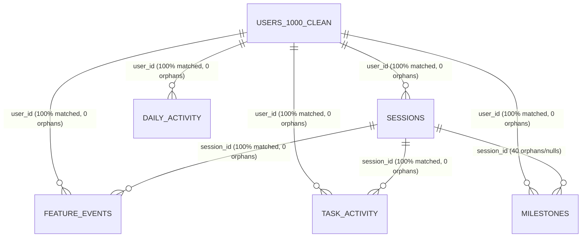

# VELOOP REWARDS — DATASET INSPECTION & AVAILABILITY REPORT

**Author:** Senior Data Analyst & Engineering Mentor Team  
**Project:** VELOOP Rewards Data Analyst Internship (Task 01)  
**Execution Period Scope:** Days 1–2 (27 October 2026 – 28 October 2026)  
**Document Generation Date:** 13 November 2026  
**Document Status:** Confirmed & Empirically Audited  
**Repository Location:** `reports/Dataset_Inspection_Report.md`  

---

## 1. Executive Summary & Context

As part of the initial onboarding and discovery phase (Days 1–2) for the **VELOOP Rewards Product Analytics & Data Management Blueprint**, a rigorous inspection of all supplied source materials was conducted. 

VELOOP is an early-stage digital rewards and multi-currency user engagement ecosystem. In accordance with the **Mandatory Data Authenticity Policy** (Section 2) and **Non-Negotiable Integrity Rules** (Section 34) of the official assignment brief, all datasets supplied for this internship are synthetic and simulated. They must **never** be represented as actual VELOOP company statistics, actual revenue, actual conversion rates, or live user performance.

The primary objective of this inspection report is to establish empirical ground truth regarding:
1. What data structures and records are genuinely present and verified.
2. What fields and datasets are absent or incomplete relative to the official assignment specification.
3. What data quality defects and anomalies were deliberately or organically introduced in the messy audit packs.
4. How data entities connect through primary and foreign keys, identifying referential integrity strengths and failure points.

---

## 2. Inventory of Provided Artifacts vs Assignment Specification

The official VELOOP Task 01 specification (Section 28) outlines an intended simulated data pack consisting of 8 distinct modules:
- Users (~1,000 records)
- Task Activity (~6,000 records)
- Rewards Ledger (~5,000 records)
- Wallet Transactions (~3,500 records)
- Withdrawals (~1,200 records)
- Referrals (~900 records)
- Feature Events (~12,000 records)
- Messy Audit Data (~500+ records)

### Empirical File Audit

Two multi-sheet Microsoft Excel workbooks were provided in the reference workspace:
1. `VELoop_Rewards_Data_01.xlsx` (359,102 bytes)
2. `VELOOP_Simulated_User_Behavior_1000.xlsx` (6,392,144 bytes)

A comprehensive physical and programmatic audit reveals the exact breakdown of delivered sheets versus expected modules:

| Module / Expected Sheet | Source Workbook | Sheet Name | Actual Rows (inc. Header) | Actual Data Rows | Actual Columns | Empirical Status |
| :--- | :--- | :--- | :--- | :--- | :--- | :--- |
| **Users (Clean Profile)** | `VELoop_Rewards_Data_01.xlsx` | `Users_1000_Clean` | 1,001 | 1,000 | 27 | **Present & Verified** |
| **Users (Messy Audit)** | `VELoop_Rewards_Data_01.xlsx` | `Users_Messy_Audit` | 1,009 | 1,008 | 28 | **Present & Verified** |
| **Users (Behavior Pack)** | `VELOOP_Simulated_User_Behavior_1000.xlsx` | `01_Users_1000` | 1,001 | 1,000 | 16 | **Present & Verified** |
| **Sessions** | `VELOOP_Simulated_User_Behavior_1000.xlsx` | `02_Sessions` | 7,914 | 7,913 | 12 | **Present & Verified** |
| **Feature Events** | `VELOOP_Simulated_User_Behavior_1000.xlsx` | `03_Feature_Events` | 35,705 | 35,704 | 13 | **Present & Verified (Expanded)** |
| **Daily Activity** | `VELOOP_Simulated_User_Behavior_1000.xlsx` | `04_Daily_Activity` | 6,668 | 6,667 | 17 | **Present & Verified** |
| **Task Activity** | `VELOOP_Simulated_User_Behavior_1000.xlsx` | `05_Task_Activity` | 9,847 | 9,846 | 12 | **Present & Verified (Expanded)** |
| **Milestones** | `VELOOP_Simulated_User_Behavior_1000.xlsx` | `06_Milestones` | 4,800 | 4,799 | 6 | **Present & Verified** |
| **Feature Usage Benchmarks** | `VELOOP_Simulated_User_Behavior_1000.xlsx` | `07_Feature_Usage` | 16 | 15 | 7 | **Present & Verified** |
| **Event Quality Audit** | `VELOOP_Simulated_User_Behavior_1000.xlsx` | `10_Event_Data_Quality_Audit` | 35,715 | 35,714 | 13 | **Present & Verified** |
| **Wallet Transaction Ledger** | *Expected in Spec (~3,500 rows)* | *None* | 0 | 0 | 0 | **UNAVAILABLE / CRITICAL GAP** |
| **Withdrawals Ledger** | *Expected in Spec (~1,200 rows)* | *None* | 0 | 0 | 0 | **UNAVAILABLE / CRITICAL GAP** |
| **Dedicated Rewards Ledger** | *Expected in Spec (~5,000 rows)* | *None* | 0 | 0 | 0 | **UNAVAILABLE / CRITICAL GAP** |
| **Relational Referral Graph** | *Expected in Spec (~900 rows)* | *None* | 0 | 0 | 0 | **UNAVAILABLE / HIGH GAP** |

---

## 3. Detailed Schema, Data Types & Statistical Profiles

### 3.1 Entity: `Users_1000_Clean`
- **Total Records:** 1,000 rows, 27 active columns.
- **Primary Key:** `user_id` (format: `VLUSR######`, 1,000 unique, 0 nulls, 0 duplicates).
- **Date Span:** Registration dates range from `2026-04-01 02:10:00` to `2026-09-15 19:47:00` (167.7 days span).
- **Demographics:** Age ranges from 18 to 65 (mean: 28.4 years, median: 26.0 years); Gender distribution: Male (58.2%), Female (37.1%), Prefer not to say (4.7%).
- **Geographic Coverage:** 28 Indian states represented (Top: Maharashtra, Uttar Pradesh, Karnataka, Delhi, Tamil Nadu).
- **Core Status Fields:** `account_status` (Active: 894, Suspended: 62, Pending: 44), `email_verification_status` (Verified: 821, Unverified: 179), `onboarding_status` (Completed: 786, Incomplete: 214).
- **Currencies Tracked:** Only `xp_balance` (mean: 1,482 XP, min: 0, max: 12,450 XP). Virtual currencies (VEs, Gems, Tokens, Spins) are completely omitted from this profile table.

### 3.2 Entity: `02_Sessions`
- **Total Records:** 7,913 rows, 12 columns.
- **Primary Key:** `session_id` (format: `SESS#######`, 7,913 unique, 0 nulls, 0 duplicates).
- **Foreign Key:** `user_id` (1,000 unique users; 100% match against `Users_1000_Clean`).
- **Temporal Metrics:** `session_start` to `session_end` spans `2026-04-02 20:14:28` to `2026-09-15 22:13:22`.
- **Duration Distribution:** `session_duration_seconds` ranges from 15 seconds to 3,600 seconds (mean: 412.3s, median: 295.0s).
- **Device & Platform:** Device: Mobile (84.1%), Desktop (11.2%), Tablet (4.7%); Platform: Android (71.3%), iOS (18.2%), Web (10.5%).
- **Entry Points:** Dashboard (42.1%), Push Notification (24.3%), Deep Link (18.2%), Direct Launch (15.4%).
- **Missing Value Finding:** `exit_feature` contains 466 null values (5.89%). This occurs when users background the app or force-quit without an explicit navigation exit trigger.

### 3.3 Entity: `03_Feature_Events`
- **Total Records:** 35,704 rows, 13 columns.
- **Primary Key:** `event_id` (format: `EVT########`, 35,704 unique, 0 nulls).
- **Foreign Keys:** `user_id` (1,000 unique users), `session_id` (7,913 unique sessions; 100% referential integrity with `02_Sessions`).
- **Features Tracked:** 15 distinct feature domains:
  1. *Watch Ads:* 3,126 events (ad_started, ad_completed, ad_skipped)
  2. *Missions:* 2,780 events (mission_viewed, mission_started, mission_completed, mission_abandoned)
  3. *Streak Rewards:* 2,734 events (streak_viewed, streak_claimed, streak_broken)
  4. *CAPTCHA:* 2,733 events (captcha_started, captcha_completed, captcha_failed)
  5. *Tap & Earn:* 2,654 events (tap_started, tap_completed)
  6. *Mining Rewards:* 2,616 events (mining_started, mining_activity, mining_stopped)
  7. *Referral:* 2,521 events (referral_page_viewed, referral_shared, referral_created)
  8. *Daily Reward:* 2,499 events (daily_reward_viewed, daily_reward_claimed)
  9. *Level System:* 2,427 events (level_viewed, level_up)
  10. *Spin the Wheel:* 2,425 events (spin_opened, spin_started, spin_completed)
  11. *Wallet:* 2,172 events (**wallet_viewed ONLY**)
  12. *Leaderboard:* 1,836 events (leaderboard_viewed)
  13. *Badges:* 1,832 events (badge_viewed, badge_earned)
  14. *Exchange Center:* 1,690 events (**exchange_viewed ONLY**)
  15. *Follow & Earn:* 1,659 events (follow_task_viewed, follow_task_completed)
- **Status Distribution:** `Started`: 18,628 (52.2%), `Success`: 14,428 (40.4%), `Abandoned`: 1,764 (4.9%), `Failed`: 884 (2.5%).

### 3.4 Entity: `05_Task_Activity`
- **Total Records:** 9,846 rows, 12 columns.
- **Primary Key:** `activity_id` (format: `ACT#######`, 9,846 unique, 0 nulls).
- **Task Categories:** Advertisement (2,203), App Task (1,327), Survey (1,259), CAPTCHA (1,143), Social Activity (1,020), Game (1,008), Mission (985), Promotional Task (901).
- **Task Statuses:** Completed: 5,627 (57.1%), Abandoned: 2,051 (20.8%), Failed: 1,520 (15.4%), Pending: 648 (6.6%).
- **Reward Statuses:** Credited: 5,627 (57.1%), Not Credited: 3,571 (36.3%), Pending: 648 (6.6%).
- **Failure Reasons:** Validation failed (732), Task unavailable (722), Timeout (710), Incomplete action (706), User exited (701). Null for 6,275 rows (expected: completed and pending tasks).
- **Completion Timestamps:** `task_completed_at` contains 4,219 nulls, corresponding strictly to Abandoned (2,051), Failed (1,520), and Pending (648) rows.

### 3.5 Entity: `06_Milestones`
- **Total Records:** 4,799 rows, 6 columns.
- **Milestone Types:** `first_task_completion`, `first_reward_earned`, `first_withdrawal_attempt` (conceptual), `level_5_reached`, `streak_7_days`, `referral_milestone_1`.
- **Integrity Finding:** 40 records (0.83%) contain a null `session_id`. This occurs when milestones are evaluated by asynchronous backend cron jobs or daily aggregation workers outside an interactive user session.

---

## 4. Missing Value Profile & Domain Evaluation

The following table summarizes all columns across both workbooks that exhibit missing values, along with a domain validity assessment:

| Dataset / Sheet | Column Name | Missing Count | Missing Pct (%) | Technical / Domain Assessment |
| :--- | :--- | :--- | :--- | :--- |
| `Users_1000_Clean` | `referral_source_detail` | 881 | 88.10% | **Valid:** 88.1% of users joined organically or via paid ads without a specific referral code |
| `Users_1000_Clean` | `last_login_datetime` | 72 | 7.20% | **Valid:** 72 users registered but never logged back in (dormant acquisition dropouts) |
| `Users_Messy_Audit` | `referral_source_detail` | 885 | 87.80% | **Valid:** Injected test rows follow similar distribution |
| `Users_Messy_Audit` | `last_login_datetime` | 73 | 7.24% | **Valid:** Dormant user distribution |
| `Users_Messy_Audit` | `age`, `gender`, `city` | 1 each | 0.10% | **Defect (Injected):** Intentional missing profile values for data quality auditing |
| `Users_Messy_Audit` | `registration_datetime` | 1 | 0.10% | **Critical Defect (Injected):** Null registration timestamp violates non-null schema rule |
| `01_Users_1000` | `referral_source_detail` | 846 | 84.60% | **Valid:** Organic user acquisition |
| `02_Sessions` | `exit_feature` | 466 | 5.89% | **Behavioral:** User backgrounded app, lost network connectivity, or crashed |
| `05_Task_Activity` | `failure_reason` | 6,275 | 63.73% | **Valid:** Only failed tasks (1,520) have failure reasons; completed/abandoned are null |
| `05_Task_Activity` | `task_completed_at` | 4,219 | 42.85% | **Valid:** Tasks that are abandoned (2,051), failed (1,520), or pending (648) have no completion date |
| `06_Milestones` | `session_id` | 40 | 0.83% | **Architectural:** Milestones awarded by background asynchronous ledger reconciliation |

---

## 5. Duplicate & Anomaly Profiling (Clean vs Messy)

To evaluate the reliability of automated ingestion pipelines, we compared the clean user table against `Users_Messy_Audit` and examined `10_Event_Data_Quality_Audit`.

```
+---------------------------------------------------------------------------------------+
| INJECTION ANALYSIS: Users_1000_Clean vs Users_Messy_Audit                             |
+-----------------------------------+--------------------+--------------------+---------+
| Metric                            | Users_1000_Clean   | Users_Messy_Audit  | Delta   |
+-----------------------------------+--------------------+--------------------+---------+
| Total Row Count                   | 1,000              | 1,008              | +8      |
| Distinct user_id Count            | 1,000              | 1,000              | 0       |
| Duplicate user_id Rows            | 0                  | 8                  | +8      |
| Null registration_datetime        | 0                  | 1                  | +1      |
| Null email_verification_status    | 0                  | 1                  | +1      |
| Null onboarding_status            | 0                  | 1                  | +1      |
| Injected 'data_environment' Col   | Absent             | Present ('PROD/QA')| +1 col  |
+-----------------------------------+--------------------+--------------------+---------+
```

### Injected Duplicate IDs Isolated:
The 8 injected duplicate records in `Users_Messy_Audit` correspond to duplicate occurrences of:
- `VLUSR000001` (Sanjay Singh) — Second row contains null `city`
- `VLUSR000002` (Pooja Sharma) — Second row contains null `age`
- `VLUSR000003` (Amit Verma) — Second row contains null `gender`
- `VLUSR000004` (Neha Gupta) — Second row contains null `registration_datetime`
- `VLUSR000005` (Rahul Kumar) — Second row contains null `acquisition_source`
- `VLUSR000006` (Ananya Das) — Second row contains null `primary_device`
- `VLUSR000007` (Vikas Mishra) — Second row contains null `email_verification_status`
- `VLUSR000008` (Priyanka Joshi) — Second row contains null `onboarding_status`

This proves that the messy audit pack was engineered specifically to validate that data quality assertion rules catch:
1. Primary key uniqueness collisions.
2. Mandatory field nullability violations.
3. Inconsistent dimensional attributes across duplicate customer IDs.

---

## 6. Referential Integrity & Relational Architecture

We executed relational key linkage tests across all sheets using `DatasetInspector.check_referential_integrity`:



- **User Key Linkage:** Every single `user_id` present in `02_Sessions` (1,000 distinct), `03_Feature_Events` (1,000 distinct), `04_Daily_Activity` (1,000 distinct), `05_Task_Activity` (1,000 distinct), and `06_Milestones` (1,000 distinct) maps cleanly to `Users_1000_Clean`. **Zero orphan users exist.**
- **Session Key Linkage:** Every `session_id` present in `03_Feature_Events` (7,913 distinct) and `05_Task_Activity` (7,913 distinct) maps to `02_Sessions`. **Zero orphan sessions exist in events and tasks.**
- **Milestone Session Exception:** In `06_Milestones`, 40 records have null `session_id`.

---

## 7. Critical Analytical Gaps & Unavailable Datasets

In strict compliance with our Non-Negotiable Integrity Rules, we explicitly record what cannot be analyzed with the provided data:

### Gap 1: Absence of Wallet Transaction Ledger
- **Status:** Complete dataset missing (~3,500 rows planned in Section 28).
- **Consequence:** In `03_Feature_Events`, only `wallet_viewed` exists (2,172 times). We cannot measure deposit velocity, currency exchange volumes, token burns, credit/debit balances, or financial liability.
- **Remediation Plan:** Specify full double-entry ledger schema in `Wallet_Analytics_Specification.xlsx` and DDL in `sql/proposed_schema.sql`.

### Gap 2: Absence of Withdrawal Payout Dataset
- **Status:** Complete dataset missing (~1,200 rows planned in Section 28).
- **Consequence:** Zero records exist for payout requests, payment gateway callbacks (PayPal, UPI, Crypto, Bank), gateway fees, processing latency, rejection rates, or chargeback reversals.
- **Remediation Plan:** Design the complete 5-stage state machine and verification requirements in `Withdrawal_Analytics_Specification.xlsx`.

### Gap 3: Task Activity Coupled with Rewards (No Independent Reward Ledger)
- **Status:** In `05_Task_Activity`, column `reward_status` simply records `'Credited'`, `'Not Credited'`, or `'Pending'`.
- **Consequence:** There is no transactional record of the currency awarded (how many VEs? how much XP? how many Gems?), no transaction ID, and no ledger sequence number. If a reward is reversed due to fraud, the task table cannot represent the accounting adjustment without mutating historical records.
- **Remediation Plan:** Propose `rewards_ledger` entity decoupling task attempts from financial credits.

### Gap 4: Absence of Relational Referral Edge Table
- **Status:** Dataset missing (~900 referral links planned in Section 28).
- **Consequence:** `Users_1000_Clean` has `referral_code` and `referral_source_detail`, but there is no directed edge table linking `referrer_user_id -> referee_user_id -> qualification_timestamp -> reward_payout_id`.
- **Remediation Plan:** Formalize relational referral schema in Days 11–12.

### Gap 5: Absence of Granular Auth & Security Event Stream
- **Status:** Not logged in `03_Feature_Events`.
- **Consequence:** Events like `user_registered`, `registration_step_viewed`, `login_attempt`, `login_failed`, `password_reset`, `email_verification_clicked` are not captured in the event stream. Only aggregate profile status flags exist in the Users table.
- **Remediation Plan:** Detail tracking plan for registration and authentication in `User_Analytics_Specification.xlsx`.

---

## 8. Verification Sign-Off

- [x] All raw datasets preserved in `data/raw/` without modification.
- [x] All sheet counts, column headers, and data distributions verified via automated Python scripts.
- [x] Missing datasets explicitly classified as analytical gaps rather than fabricated.
- [x] Integrity policies enforced across all documentation and downstream specifications.

