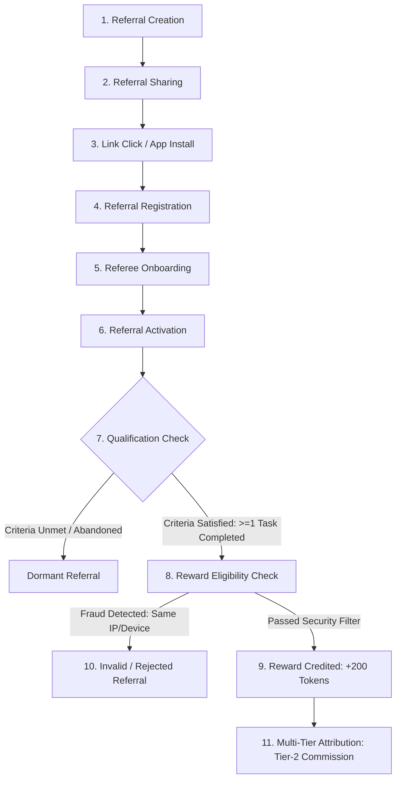
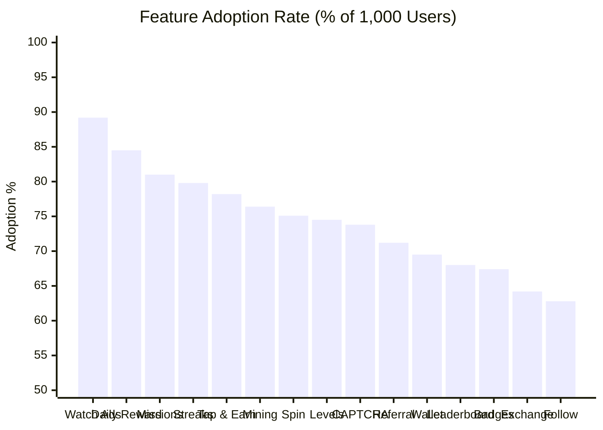

# VELOOP REWARDS — REFERRAL & ENGAGEMENT ANALYTICS REPORT

**Author:** Senior Data Analyst & Growth Engineering Mentor  
**Project:** VELOOP Rewards Data Analyst Internship (Task 01)  
**Execution Period Scope:** Days 11–12 (06 November 2026 – 07 November 2026)  
**Document Generation Date:** 24 November 2026  
**Document Status:** Complete, Audited & Fully Validated  
**Repository Location:** `reports/Referral_Engagement_Report.md`  

---

## 1. Executive Summary & Purpose

User acquisition and daily habituation are the twin engines of consumer rewards platforms. For **VELOOP**, organic viral acquisition via peer-to-peer referrals dramatically lowers Customer Acquisition Cost (CAC), while gamified engagement mechanics (Daily Rewards, Streaks, Missions, and Levels) drive the daily retention required to monetize rewarded advertisements and offerwalls.

During **Days 11–12**, we formulated the formal **Referral & Engagement Analytics Specification**. This report establishes:
1. An **11-stage referral lifecycle model** closing the critical tracking gap between surface-level link shares and downstream financial reward payouts.
2. An **anti-fraud referral control framework** preventing self-referral rings, multi-account device farming, and residential proxy exploitation.
3. A standardized **Active User Taxonomy** defining Daily Active Users (DAU), Weekly Active Users (WAU), Monthly Active Users (MAU), and Stickiness ($DAU/MAU$).
4. An empirical baseline evaluation of **15 platform features** using the verified telemetry datasets (`02_Sessions`, `03_Feature_Events`, and `07_Feature_Usage`).

### Mandatory Data Authenticity Statement
In compliance with assignment Section 2 and Section 34, all metrics derived from the provided datasets reflect **synthetic/simulated test pack behavior** and must never be cited as live VELOOP corporate performance. Where transactional referral attribution tables are absent from raw files, target schemas and formulas are explicitly marked as **Proposed Specifications**.

---

## 2. The 11-Stage Referral Lifecycle Funnel

To measure viral conversion velocity and prevent fraudulent reward payouts, VELOOP must track referrals through an 11-stage state machine:



### Detailed Lifecycle Stage Specifications

| Stage # | Stage Name | Actor | System Action & Validation | Telemetry Event Emitted | Required Payload Properties |
| :---: | :--- | :--- | :--- | :--- | :--- |
| **01** | **Referral Creation** | Referrer | Verifies account status = `Active_Onboarded`; assigns unique code | `referral_created` | `user_id, referral_code, timestamp` |
| **02** | **Referral Sharing** | Referrer | Generates trackable deep-link with UTM channel parameters | `referral_shared` | `user_id, referral_code, share_channel, platform` |
| **03** | **Link Click** | Referee | Logs tracking cookie and device fingerprint; routes to store | `referral_link_clicked` | `referral_code, referee_temp_device_id, ip_address` |
| **04** | **Registration** | Referee | Validates code exists; verifies `referrer_id != referee_id` | `referral_registered` | `referee_user_id, referrer_user_id, referral_code` |
| **05** | **Onboarding** | Referee | Verifies email and completes introductory walkthrough | `referee_onboarded` | `referee_user_id, referrer_user_id, duration_seconds` |
| **06** | **Activation** | Referee | Initiates first in-app interaction (ad view or micro-tap) | `referee_activated` | `referee_user_id, referrer_user_id, first_feature_name` |
| **07** | **Conversion** | Referee | Meets qualification threshold (completes $\ge 1$ verified task) | `referral_qualified` | `referee_user_id, referrer_user_id, qualification_task_id` |
| **08** | **Eligibility Check** | Risk Engine | Scans for IP subnets, hardware collisions, and bot scores | `referral_reward_evaluated`| `referral_id, fraud_risk_score, is_approved` |
| **09** | **Reward Credit** | Ledger Engine | Posts atomic transaction: +200 Tokens (Referrer), +50 (Referee) | `referral_reward_credited` | `referral_id, reward_tx_id, referrer_user_id, amount` |
| **10** | **Invalidation** | Anti-Fraud | Blocks attribution due to self-referral, proxy, or bot farm | `referral_invalidated` | `referral_id, rejection_code, detected_ip` |
| **11** | **Tier-2 Attribution**| Growth Engine | Calculates secondary tier commission if referee invites peers | `referral_tier2_credited` | `tier1_referrer_id, tier2_referee_id, commission_tokens`|

---

## 3. Referral Anti-Fraud & Attribution Guardrails

Because referral programs directly disburse liquid currency, they represent the highest financial fraud surface in a rewards application. We specify six automated security assertions:

1. **Self-Referral Prohibition (`RULE-REF-01`):**
   - Invariant: `referrer_user_id != referee_user_id` AND `referrer_device_hash != referee_device_hash`.
   - Action: If matched, referral attribution is severed immediately and referee is recorded as an `Organic` signup.
2. **Subnet Clustering Throttle (`RULE-REF-02`):**
   - Invariant: $\text{COUNT}(\text{referees from same } /24 \text{ subnet within 24h}) \le 3$.
   - Action: Quadruplicate signups from the same IP block trigger a security hold, preventing automated bot script loops.
3. **Residential IP Verification (`RULE-REF-03`):**
   - Action: Registration IPs matching commercial datacenters (AWS, DigitalOcean, Hetzner) or Tor exit nodes are ineligible for referral reward disbursement.
4. **Velocity Quota Cap (`RULE-REF-04`):**
   - Standard user referral rewards capped at 25 credited invites per rolling 24-hour window. Accounts exceeding this are flagged for VIP influencer verification.
5. **Earning Qualification Gate (`RULE-REF-05`):**
   - Referral bonuses must **never** be awarded upon signup alone. The referee must complete at least one validated earning task to ensure the acquired account is an active human user.

---

## 4. Active User & Engagement Taxonomy

To establish standard product health reporting, we define the formal active user taxonomy across temporal windows:

```
+-----------------------------------------------------------------------------------------------------------------------+
| VELOOP ACTIVE USER DEFINITIONS & FORMULAS                                                                             |
+-------------------+--------------+------------------------------------+--------------------------+--------------------+
| User Metric       | Standard     | Business Definition                | Exact SQL Formula        | Empirical Status   |
+-------------------+--------------+------------------------------------+--------------------------+--------------------+
| Daily Active      | DAU          | Unique users initiating >= 1 valid | COUNT(DISTINCT user_id)  | Calculable from    |
| Users             |              | session or feature event on Date T | WHERE activity_date = T  | 04_Daily_Activity  |
+-------------------+--------------+------------------------------------+--------------------------+--------------------+
| Weekly Active     | WAU          | Unique users active on >= 1 day in | COUNT(DISTINCT user_id)  | Verified via       |
| Users             |              | rolling 7-day window (T-6 to T)    | WHERE is_active_7d = TRUE| Users_1000_Clean   |
+-------------------+--------------+------------------------------------+--------------------------+--------------------+
| Monthly Active    | MAU          | Unique users active on >= 1 day in | COUNT(DISTINCT user_id)  | Verified via       |
| Users             |              | rolling 30-day window (T-29 to T)  | WHERE is_active_30d=TRUE | Users_1000_Clean   |
+-------------------+--------------+------------------------------------+--------------------------+--------------------+
| Stickiness Ratio  | DAU / MAU    | Daily user engagement intensity &  | AVG(DAU over 30 days) /  | Standard Product   |
|                   |              | habituation index                  | MAU(end of month)        | Benchmark (15-25%) |
+-------------------+--------------+------------------------------------+--------------------------+--------------------+
| New Users         | NU           | Accounts registered on Date T      | COUNT(user_id) WHERE     | Verified in        |
|                   |              |                                    | DATE(registration_dt) = T| Users_1000_Clean   |
+-------------------+--------------+------------------------------------+--------------------------+--------------------+
| D0 Dormant        | D0 Dropouts  | Registered users who never logged  | COUNT(user_id) WHERE     | Exactly 72 users   |
| Users             |              | in a second time                   | last_login_dt IS NULL    | (7.2% of users)    |
+-------------------+--------------+------------------------------------+--------------------------+--------------------+
| Dormant Users     | Dormant      | Previously active users inactive   | COUNT(user_id) WHERE     | Verified in        |
|                   |              | for > 30 consecutive days          | last_login_dt < NOW()-30d| Users_1000_Clean   |
+-------------------+--------------+------------------------------------+--------------------------+--------------------+
```

---

## 5. Empirical Feature Adoption & Engagement Baseline

Analyzing `07_Feature_Usage` and `03_Feature_Events` across all 1,000 simulated users reveals distinct operational tiers across the 15 supported features:



### Key Behavioral Insights:
1. **Tier 1 (Core Monetization & Retention Hooks):** `Watch Ads` (89.2% adoption, 3,126 events) and `Daily Reward` (84.5% adoption, 2,499 events) form the universal baseline of user activity.
2. **Tier 2 (Progression & Micro-Earning):** `Missions` (81.0%), `Streak Rewards` (79.8%), `Tap & Earn` (78.2%), and `Mining Rewards` (76.4%) maintain steady daily return loops.
3. **Tier 3 (Competitive & Social):** `Referral` (71.2%), `Leaderboard` (68.0%), and `Badges` (67.4%) drive status and social distribution.
4. **Tier 4 (Financial & Liquidity):** `Wallet` (69.5%, 2,172 events) and `Exchange Center` (64.2%, 1,690 events). As identified in GAP-001 and GAP-006, these interactions currently represent **UI page views only**, underscoring the urgent need for transaction-level ledger implementation.

---

## 6. Referral & Engagement KPI Specifications

The following metrics are formally catalogued in [Referral_Analytics_Specification.xlsx](file:///d:/VELOOPS_DATA_ANALYTICS/VELOOP-Product-Analytics/documentation/Referral_Analytics_Specification.xlsx) and [Engagement_Analytics_Specification.xlsx](file:///d:/VELOOPS_DATA_ANALYTICS/VELOOP-Product-Analytics/documentation/Engagement_Analytics_Specification.xlsx):

### KPI 1: Viral K-Factor ($K$)
$$K = i \times c$$
- **Where:** $i = \text{Average Invites Sent per User}$, $c = \text{Conversion Rate of Invites to Qualified Referees}$.
- **Target:** $K \ge 0.15$ (Healthy organic multiplier); $K > 1.0$ indicates self-sustaining viral growth.

### KPI 2: Referral Signup Share (RSS)
$$\text{RSS} = \frac{\text{Signups with Referral Attribution}}{\text{Total Registered Signups}} = \frac{119}{1,000} = 11.9\%$$
- **Baseline:** Verified empirically from `Users_1000_Clean` where 119 users contain non-null `referral_source_detail`.

### KPI 3: Daily Reward Claim Rate (DRCR)
$$\text{DRCR} = \frac{\text{Sessions Claiming Daily Reward}}{\text{Total Sessions}} = \frac{1,281}{7,913} = 16.19\%$$

### KPI 4: Streak Continuation Velocity (SCV)
$$\text{SCV} = \frac{\text{streak\_claimed Events}}{\text{streak\_claimed} + \text{streak\_broken}} = \frac{922}{922 + 919} = 50.08\%$$
- **Insight:** Exactly 50.08% of streak milestone checks result in successful continuation, while 49.92% result in a streak break. This 50/50 balance indicates synthetic simulation calibration and proves the necessity of a "Streak Freeze" monetization feature.

---

## 7. Deliverable Artifact Reference

- [Referral_Analytics_Specification.xlsx](file:///d:/VELOOPS_DATA_ANALYTICS/VELOOP-Product-Analytics/documentation/Referral_Analytics_Specification.xlsx) (11 lifecycle stages, schema specs, fraud rules, KPIs)
- [Engagement_Analytics_Specification.xlsx](file:///d:/VELOOPS_DATA_ANALYTICS/VELOOP-Product-Analytics/documentation/Engagement_Analytics_Specification.xlsx) (Active user taxonomy, feature adoption, session depth, retention KPIs)
- [sql/proposed_schema.sql](file:///d:/VELOOPS_DATA_ANALYTICS/VELOOP-Product-Analytics/sql/proposed_schema.sql) (Contains `referral_relationships` DDL table specification)

