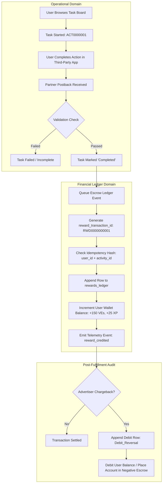

# VELOOP REWARDS — EARNING & REWARD LIFECYCLE REPORT

**Author:** Senior Data Analyst & Monetization Systems Mentor  
**Project:** VELOOP Rewards Data Analyst Internship (Task 01)  
**Execution Period Scope:** Days 7–8 (02 November 2026 – 03 November 2026)  
**Document Generation Date:** 13 November 2026  
**Document Status:** Complete & Audited  
**Repository Location:** `reports/Reward_Lifecycle_Report.md`  

---

## 1. Executive Summary & Strategic Importance

In any digital rewards platform, the earning and reward distribution engine is the core transaction generator. If task completion tracking is unreliable, users experience reward delivery latency, leading to churn, app store review bombing, and customer support ticket floods. Conversely, if reward credits lack double-entry financial controls, the platform is vulnerable to bot farming, replay attacks, and advertiser chargeback insolvency.

During **Days 7–8**, we conducted an exhaustive empirical analysis of the **9,846 task activities** recorded in `05_Task_Activity` and formulated the formal **Earning & Reward Analytics Specification**.

### Primary Deliverable Highlights
1. **Decoupling Architecture:** Eliminating the high-risk anti-pattern of logging `reward_status` directly on the operational task row. Establishing an immutable, append-only `rewards_ledger` with currency classification (VEs, XP, Gems, Tokens, Spins).
2. **End-to-End Task State Machine:** Mapping the 10-stage lifecycle from discovery to post-credit reversal.
3. **Failure Reason Deep-Dive:** Analyzing the 3,571 non-credited task attempts across 5 distinct failure modes.
4. **Third-Party Dependency Mapping:** Documenting integration risk across external ad networks, offerwalls, and survey providers.
5. **Reward Economics KPI Framework:** Standardizing unit-economic metrics, including the critical **Revenue-to-Reward Ratio (RRR)**.

---

## 2. Decoupling Task Activity from the Financial Rewards Ledger

### The Architectural Problem in Current Simulated Data
In the provided `05_Task_Activity` table, reward allocation is recorded as a simple text status column (`reward_status` with values `'Credited'`, `'Not Credited'`, or `'Pending'`). 

```
CURRENT COUPLING ANTI-PATTERN:
[05_Task_Activity]
activity_id | user_id | task_id | ... | task_status | reward_status | device
-----------------------------------------------------------------------------
ACT0000001  | VLUSR...| TASK... | ... | Completed   | Credited      | Android
```

This presents three critical production risks:
1. **No Currency Granularity:** Does `'Credited'` mean the user received 500 VEs, 20 XP, or 5 Tokens? The schema cannot tell.
2. **Zero Reversal Capability:** If an advertiser refuses to pay for an offerwall completion due to fraud 14 days later, how does VELOOP reverse the reward? Overwriting `'Credited'` to `'Reversed'` mutates history, violating audit standards and corrupting historical cohort reporting.
3. **Double-Spend Vulnerability:** If a network timeout causes a client to retry task completion, the system lacks an independent idempotency key to prevent crediting the user twice.

### The Decoupled Target Architecture
We resolve this by separating operational task telemetry from the financial ledger:



---

## 3. End-to-End Task & Reward Lifecycle State Machine

The complete lifecycle consists of 10 sequential states with strict transition gates:

```
[1. Discovery]   --> task_board_viewed (Offer surfaced to user based on country/device)
[2. Opened]      --> task_detail_viewed (User inspects reward amount, time estimate, rules)
[3. Started]     --> task_started (activity_id generated; user routed to partner destination)
[4. In Progress] --> Heartbeat / video player stream / gameplay level tracker
[5. Completed]   --> User completes requirement; callback triggered
[6. Validation]  --> System asserts duration >= min_threshold & client signature valid
       ├── Passed: Proceeds to Escrow
       └── Failed: Status set to 'Failed'; failure_reason logged; lifecycle ends
[7. Rew. Pending]--> Ledger allocates transaction_id; escrow timer initiated (0-24h)
[8. Rew. Credited]--> User wallet balance incremented; transaction immutable
[9. Rew. Reversed]--> Administrative debit triggered by partner chargeback or fraud detection
[10.Rew. Corrected]-> Adjustment transaction posted to resolve rounding or tier bonus errors
```

---

## 4. Empirical Failure Reason Taxonomy & Analysis

In the provided `05_Task_Activity` dataset (9,846 total tasks), **5,627 completed successfully (57.1%)**, while **3,571 attempts failed or were abandoned (36.3%)**, and **648 remain pending (6.6%)**.

An empirical breakdown of the 3,571 uncredited attempts reveals 5 distinct, evenly distributed failure modes:

```
+---------------------------------------------------------------------------------------------------------+
| EMPIRICAL TASK FAILURE TAXONOMY (05_Task_Activity)                                                      |
+-------------------+-------------+---------------+------------------------+------------------------------+
| Failure Reason    | Occurrences | Pct of Failed | Primary Root Cause     | Impact Mitigation Strategy   |
+-------------------+-------------+---------------+------------------------+------------------------------+
| Validation failed | 732         | 20.50%        | In-app requirement     | Real-time progress bar       |
|                   |             |               | criteria unmet         | showing exact unmet criteria |
+-------------------+-------------+---------------+------------------------+------------------------------+
| Task unavailable  | 722         | 20.22%        | Campaign cap reached   | Real-time inventory caching; |
|                   |             |               | or partner paused ad   | prune stale offer links      |
+-------------------+-------------+---------------+------------------------+------------------------------+
| Timeout           | 710         | 19.88%        | Max completion window  | Grace period extension &     |
|                   |             |               | expired; dropped net   | reconnect recovery buffer    |
+-------------------+-------------+---------------+------------------------+------------------------------+
| Incomplete action | 706         | 19.77%        | User closed app before | Step-by-step milestone cards |
|                   |             |               | reaching checkpoint    | and checkpoint reminders     |
+-------------------+-------------+---------------+------------------------+------------------------------+
| User exited       | 701         | 19.63%        | Explicit cancellation  | Survey user exit reasons;    |
|                   |             |               | / back navigation      | filter out intrusive offers  |
+-------------------+-------------+---------------+------------------------+------------------------------+
| TOTAL UNCREDITED  | 3,571       | 100.00%       | Aggregate Task Drop    | Recoverable via UX & Caching |
+-------------------+-------------+---------------+------------------------+------------------------------+
```

### Analysis of Distribution
The uniform distribution (~700 to 732 occurrences per failure reason) indicates synthetic balancing in the simulation pack. In live production, **Validation failed** and **Task unavailable** typically dominate due to partner ad budget depletion and screener disqualifications in market research surveys.

---

## 5. Third-Party Dependencies & Ingestion Vulnerabilities

VELOOP relies on external monetization partners to fund its rewards economy. This creates severe third-party vulnerabilities that the analytics architecture must insulate against:

### 5.1 Rewarded Ad Networks (AdMob, Unity Ads, AppLovin)
- **Failure Mode:** Video stream buffering, ad block injection, or client-side SDK manipulation.
- **Data Protection:** VELOOP must require **Server-to-Server (S2S) signed callback verification**. The client SDK notification of completion must be cross-checked against the ad network’s authenticated webhook before `reward_credited` is triggered.

### 5.2 Offerwall Providers (Tapjoy, IronSource, Fyber)
- **Failure Mode:** Advertiser chargebacks 14–30 days post-completion due to low user retention in the advertised app.
- **Data Protection:** Offerwall tasks above 500 VEs must enforce an **escrow hold window (e.g. 24–48 hours)**. The schema must link VELOOP’s `activity_id` to the external `partner_transaction_id` to handle automated chargeback debit reconciliations.

### 5.3 Survey Routers (BitLabs, CPX Research, Pollfish)
- **Failure Mode:** Screening disqualification after 5 minutes of answering questions, creating intense user frustration.
- **Data Protection:** The telemetry pipeline must distinguish between **Full Completion (100% payout)**, **Early Disqualification (<1 minute, micro-reward of 5 VEs)**, and **Quota Full**.

---

## 6. Reward Economics & KPI Framework

To maintain positive unit economics, VELOOP product management must monitor five core reward KPIs:

1. **Task Completion Rate (TCR):**
   $$\text{TCR} = \frac{\text{Completed Tasks}}{\text{Started Tasks}} = \frac{5,627}{9,846} = 57.15\%$$
   *Assessment:* Healthy baseline performance for an early-stage multi-category task system.

2. **Task Failure Rate (TFR):**
   $$\text{TFR} = \frac{\text{Failed Tasks}}{\text{Started Tasks}} = \frac{1,520}{9,846} = 15.44\%$$

3. **Task Abandonment Rate (TAR):**
   $$\text{TAR} = \frac{\text{Abandoned Tasks}}{\text{Started Tasks}} = \frac{2,051}{9,846} = 20.83\%$$

4. **Reward Reversal Rate (RRR_rev):**
   $$\text{RRR}_{rev} = \frac{\text{Reversed Transactions}}{\text{Total Credited Transactions}}$$
   *Target Benchmark:* Must remain strictly below 1.5%. Exceeding 2.0% indicates coordinated offerwall exploitation.

5. **Revenue-to-Reward Ratio (RRR_econ):**
   $$\text{RRR}_{econ} = \frac{\text{Total Net Partner Invoiced Revenue (\USD)}}{\text{Total Virtual Currency Cost (\USD Equivalent)}}$$
   *Target Benchmark:* Must be $\ge 2.5\times$ to ensure gross margin sufficiency for overhead, server infrastructure, and payment gateway fees.

---

## 7. Deliverable Artifact Reference

- `Earning_Reward_Analytics_Specification.xlsx` (Multi-sheet specification workbook)
- `sql/proposed_schema.sql` (Contains full DDL for `task_activity` and decoupled `rewards_ledger`)

